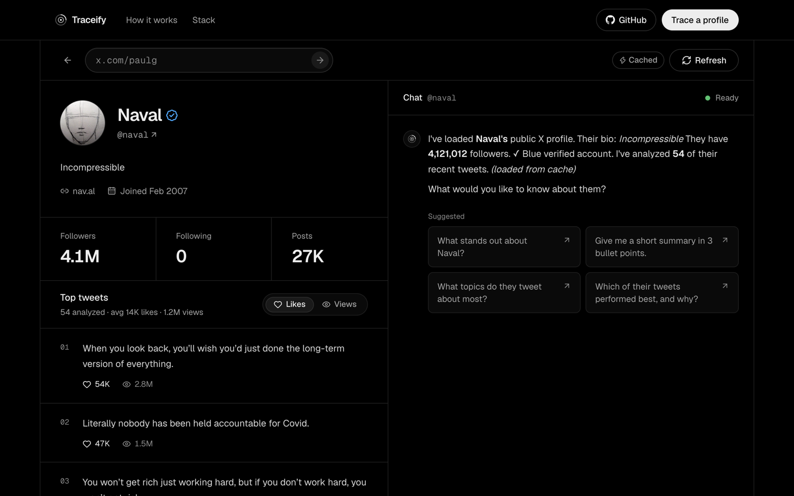
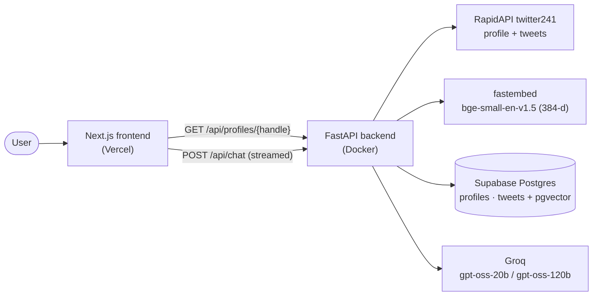

# Traceify

[](https://github.com/anmol0b/Traceify/actions/workflows/ci.yml)

> Public profile intelligence: load any public X (Twitter) profile and have a grounded AI conversation about the person, backed by semantic search over their tweets.

<!-- Add a screenshot or GIF of the profile page here:  -->

**Stack:** Next.js 16 · TypeScript · Tailwind CSS · FastAPI · Pydantic · Supabase (Postgres + pgvector) · fastembed · Groq · Docker · GitHub Actions

---

## Features

- **Any public X profile**: enter `@handle`, `handle`, or paste an `x.com/…` URL
- **~100 recent original tweets** fetched with cursor pagination (retweets and replies filtered out)
- **Engagement insights**: top tweets by likes and by views, plus per-tweet averages
- **Retrieval-augmented chat**: each question is embedded and matched against the person's tweets with pgvector, and the best matches are added to the prompt
- **Streaming answers** token by token from Groq, with model routing (a fast model for simple questions, a larger one for analysis)
- **Graceful degradation**: works without a database (in-memory cache) and without an LLM (rule-based answers)
- **24h profile cache** in Supabase, so repeat visits don't spend API quota
- **Typed error states** for invalid handles, missing and private accounts, and rate limits
- **Per-IP rate limiting** to protect the public demo's API quotas

## Architecture



**Profile request:** normalize the handle → return the cached profile if it's under 24h old → otherwise fetch the profile and paginated tweets → save the profile row → embed the tweets and upsert them. The profile is saved first because `tweets.handle` has a foreign key to `profiles.handle`.

**Chat request:** load the profile server-side, rather than trusting profile data sent by the client → embed the question and run `search_tweets()` (cosine similarity in pgvector) → build the system prompt from the profile, insights, recent tweets and the retrieved tweets → append the last 6 turns and the question → stream Groq's response as chunked plain text.

## API

| Method | Path | Description |
|---|---|---|
| `GET` | `/api/health` | Liveness, and which integrations are configured |
| `GET` | `/api/profiles/{handle}` | Profile, insights, starter message, suggested questions. `handle` may be an x.com URL |
| `POST` | `/api/profiles/{handle}/refresh` | Clear the cache and refetch |
| `POST` | `/api/chat` | `{handle, question, history[]}` → `text/plain` stream |

Errors are returned as `{"code": "...", "message": "..."}`: `invalid_handle` (422), `private_account` (403), `not_found` (404), `rate_limited` / `upstream_rate_limited` (429), `upstream_error` (502), `not_configured` (503). Interactive docs are at `/docs`.

## Project structure

```
backend/
  app/
    main.py               FastAPI app, CORS, error handling, lifespan warm-up
    config.py             Typed settings (pydantic-settings, .env)
    schemas.py            Pydantic request/response models
    errors.py             Domain errors → HTTP status codes
    rate_limit.py         Sliding-window per-IP limiter
    api/                  health · profiles · chat routes
    services/
      x_client.py         RapidAPI client, timeline parsing, insights
      profile_service.py  Cache → fetch → persist orchestration
      repo.py             Supabase persistence, TTL cache, vector search
      embeddings.py       fastembed wrapper
      chat.py             Prompt building, model routing, streaming, fallback
      profiles.py         Handle normalization, summaries, suggested questions
  tests/                  pytest suite (HTTP mocked, no network)
frontend/
  app/                    Landing page, /x/[handle] profile page
  components/             HandleSearch, ProfileCard, TweetInsights, ChatPanel, ProfileView
  lib/                    Typed API client (incl. stream reader), handle parsing
supabase/
  schema.sql              Tables, HNSW index, search_tweets() RPC, RLS
  migrate_v1_to_v2.sql    One-off migration from the original Streamlit schema
```

## Running locally

### 1. Database (optional, but needed for caching and semantic search)

Create a free project at [supabase.com](https://supabase.com) and run [`supabase/schema.sql`](supabase/schema.sql) in the SQL editor. Use the **service-role** key in the backend. RLS is enabled with no policies, so the public anon key can't touch the tables.

### 2. Backend

```bash
cd backend
python3.12 -m venv .venv && source .venv/bin/activate
pip install -r requirements.txt -r requirements-dev.txt
cp .env.example .env        # fill in your keys
uvicorn app.main:app --reload --port 8000
```

### 3. Frontend

```bash
cd frontend
npm install
cp .env.example .env.local  # NEXT_PUBLIC_API_URL=http://localhost:8000
npm run dev                 # http://localhost:3000
```

### Or with Docker

```bash
cp backend/.env.example backend/.env   # fill in your keys
docker compose up --build
```

## Configuration

| Variable | Required | Notes |
|---|---|---|
| `RAPIDAPI_KEY` | Yes | [RapidAPI](https://rapidapi.com): subscribe to **twitter241** (free tier) |
| `GROQ_API_KEY` | Recommended | [console.groq.com](https://console.groq.com). Without it, chat uses rule-based answers |
| `SUPABASE_URL`, `SUPABASE_KEY` | Recommended | Without them, profiles are cached in memory and semantic search is off |
| `ALLOWED_ORIGINS` | Prod | Comma-separated frontend origins for CORS |
| `GROQ_MODEL_FAST`, `GROQ_MODEL_SMART` | No | Override the models if Groq retires them |
| `CACHE_TTL_HOURS` | No | Default `24` |
| `NEXT_PUBLIC_API_URL` | Frontend | Backend URL, inlined at build time |

## Testing

```bash
cd backend && ruff check . && pytest -q
cd frontend && npm run lint && npm run build
```

The backend suite covers handle and URL parsing, timeline parsing, upstream error mapping, insights, prompt construction (including a regression test that the question is sent only once), streaming and fallback behavior, TTL caching, rate limiting, and the API routes (including a check that the profile is saved before its tweets). CI runs both jobs on every push.

## Deployment

- **Backend:** deploy `backend/` as a Docker web service, for example on Render or Fly.io. The embedding model is baked into the image, and the runtime needs well under 512MB of RAM. Set the env vars above, and set `ALLOWED_ORIGINS` to your frontend URL.
- **Frontend:** import `frontend/` into Vercel and set `NEXT_PUBLIC_API_URL`.

## Design decisions

- **FastAPI + Next.js instead of Streamlit.** A typed REST API with streaming responses, a separately deployable frontend, and a real loading, error and empty state for every request.
- **Groq.** Very high tokens/sec, so streamed answers start almost instantly. Questions that ask for analysis ("analyze", "compare", "why"…) are routed to the larger model, and everything else goes to the faster one.
- **Postgres + pgvector in one database.** Structured cache and embeddings live together, with no separate vector store to run. An HNSW index plus a SQL function makes per-handle similarity search a single RPC.
- **fastembed (ONNX) instead of sentence-transformers.** The same 384-dimensional embeddings without PyTorch, which keeps the container small enough for free hosting tiers.
- **Server-side profile lookup in chat.** The client sends only the handle and history, so it can't inject fake "profile facts" into the prompt.
- **Fail soft.** Database, embedding and LLM failures are logged and degrade gracefully instead of breaking the page.

## Limitations

- Only ~100 of the most recent original tweets are analyzed.
- The rate limiter is in-memory and per-process. A multi-instance deployment would need Redis.
- Data comes from a third-party RapidAPI wrapper and is subject to its availability and quotas.
